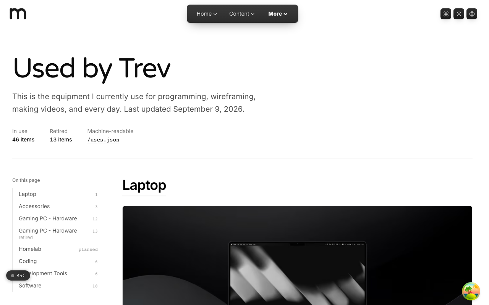
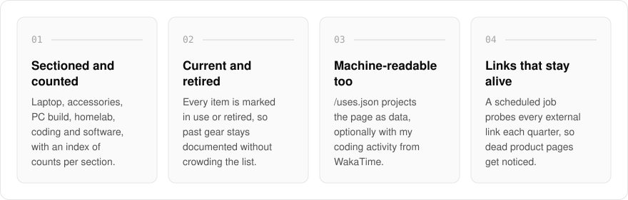
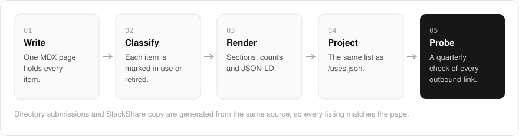

  <picture>
    <source media="(prefers-color-scheme: dark)" srcset=".github/assets/hero-dark.png">
    
  </picture>

<h1 align="center">use.me.at</h1>

<strong>The equipment I use for programming, wireframing, making videos, and every day.</strong>

  
  
  

  <a href="https://use.me.at">Website</a> ·
  <a href="#features">Features</a> ·
  <a href="#how-it-works">How it works</a> ·
  <a href="#built-with">Built with</a>

Most uses pages are written once and left alone: retired gear lingers and product links quietly die. I built use.me.at as a uses page that stays honest: the hardware, editor and software I use day to day, from my laptop and accessories to my gaming PC build, homelab, coding tools and Mac apps. Every item is marked in use or retired, every outbound link is checked each quarter, and the whole page is also published as JSON for anyone who wants the list without the layout.

  <picture>
    <source media="(prefers-color-scheme: dark)" srcset=".github/assets/overview-dark.svg">
    
  </picture>

## Why use.me.at

| The usual uses page | use.me.at |
| --- | --- |
| Old gear and current gear in one list | Every item marked in use or retired |
| Dead product links pile up | Every external link probed each quarter |
| Only readable as a page | Also published as `/uses.json` |
| One long scroll | Sections with an index and per-section item counts |

## Features

- **Sectioned uses page**: laptop, accessories, gaming PC hardware, homelab, coding, development tools and software, with an "On this page" index showing per-section item counts.
- **In use vs. retired**: every item carries a status, so past gear stays documented without cluttering what is current.
- **`/uses.json`**: a machine-readable projection of the page (software and built-with lists), optionally enriched with coding activity from WakaTime.
- **Structured data**: the page emits `WebPage` and `ItemList` JSON-LD for search engines.
- **Link liveness checks**: a scheduled job probes every external URL on the page each quarter so dead product links get noticed.
- **Listing exports**: scripts generate submission copy for uses directories and StackShare from the same source.

## How it works

  <picture>
    <source media="(prefers-color-scheme: dark)" srcset=".github/assets/flow-dark.svg">
    
  </picture>

The page is one MDX document rendered through the family's shared content components, with each item classified as in use or retired and the page emitting `WebPage` and `ItemList` JSON-LD. The same source is projected to `/uses.json`, optionally enriched with my WakaTime coding activity, and a scheduled job probes every external link each quarter. Submission copy for uses directories and StackShare is generated from that source too.

## Built with

  
  
  
  
  
  

- Next.js 16 (App Router), React 19, TypeScript
- Tailwind CSS 4
- MDX content rendered through the family's shared content components
- WakaTime API (optional) for coding activity
- Vitest and Playwright

## Part of the me.at family

use.me.at is one of my [`*.me.at`](https://me.at) apps. They share one design system, account, and app shell. Development happens in a private monorepo; this repository is the project's public-facing home.

## License

Source-available. See [LICENSE](LICENSE).
